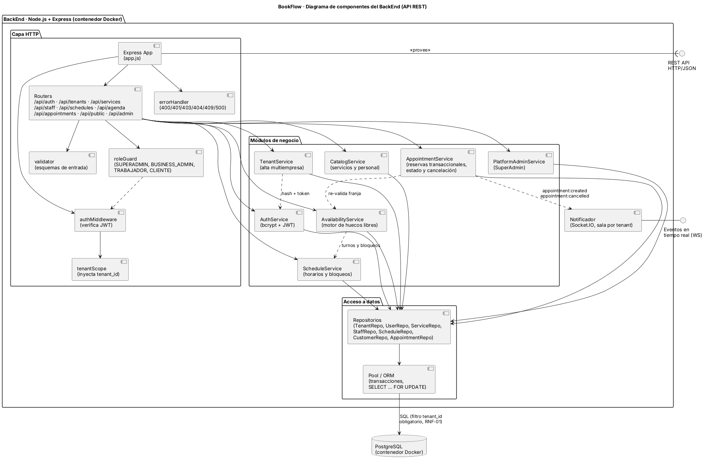
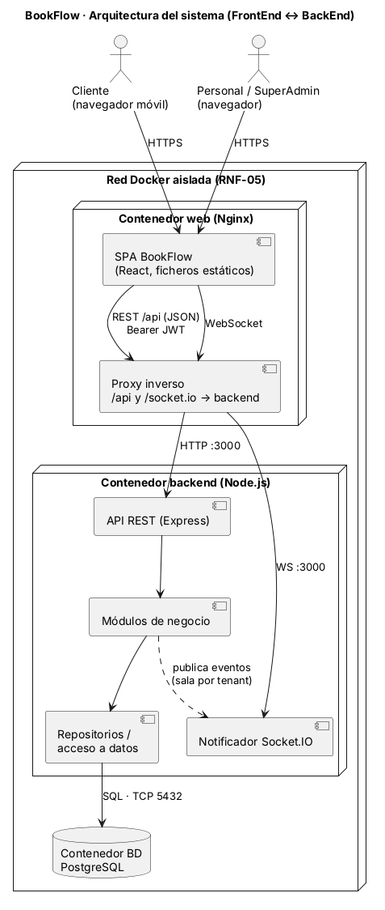
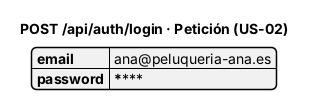
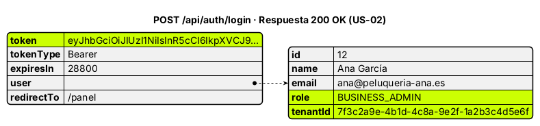
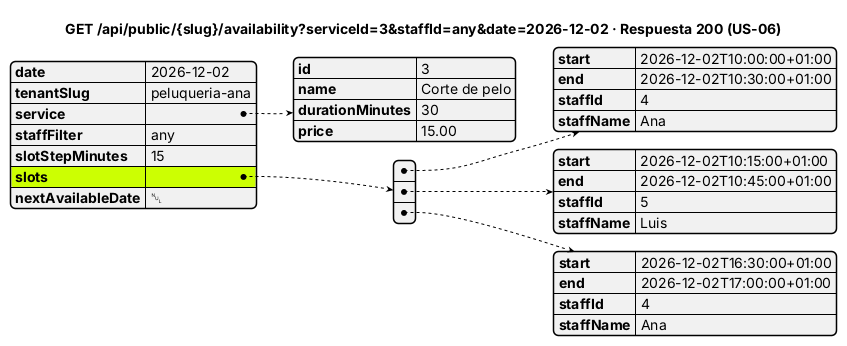
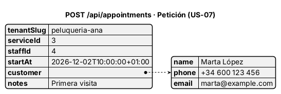
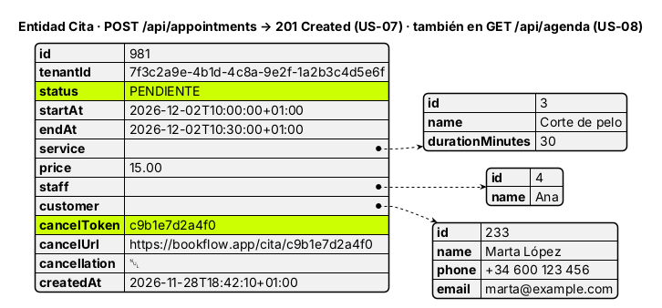
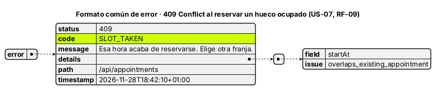
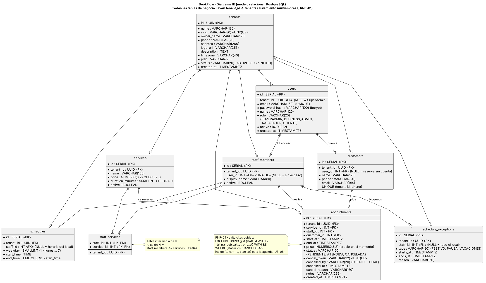

# BookFlow · BackEnd

API REST en **Node.js + Express** con **PostgreSQL**, autenticación **JWT** y
contraseñas con **bcrypt** (RNF-02). Arquitectura en capas (HTTP → negocio →
acceso a datos), multiempresa por `tenant_id` (RNF-01) y desplegada en
contenedores Docker en una red aislada (RNF-05).

## Documentación del repositorio

| Ruta | Contenido |
|------|-----------|
| [`docs/uml/`](docs/uml) | Diagramas PlantUML del Sprint 5 (fuente `.puml` + imagen `.png`) |
| [`docs/uml/componentes-backend`](docs/uml/componentes-backend.png) | Diagrama de componentes del BackEnd |
| [`docs/uml/arquitectura-sistema`](docs/uml/arquitectura-sistema.png) | Vista conjunta FrontEnd ↔ BackEnd (despliegue Docker) |
| [`docs/uml/json/`](docs/uml/json) | Diagramas JSON del contrato de la API |
| [`docs/uml/ie-modelo-datos`](docs/uml/ie-modelo-datos.png) | Diagrama IE (modelo relacional) |
| [`docs/api/openapi.yaml`](docs/api/openapi.yaml) | Especificación OpenAPI (Sprint 2) |
| [`docs/api/errores.md`](docs/api/errores.md) · [`convenciones.md`](docs/api/convenciones.md) | Guía de errores y convenciones de la API |
| [`docs/api/contract-tests/`](docs/api/contract-tests) | Pruebas de contrato (Postman / newman) |
| [`docs/der/`](docs/der) | DER del Sprint 2 (draw.io) |

Los diagramas de casos de uso, actividad y secuencia de cada historia de
usuario están adjuntos en su historia de Jira (US-01 … US-09).

## Arquitectura (diagrama de componentes)

Fuente: [`docs/uml/componentes-backend.puml`](docs/uml/componentes-backend.puml)

| Capa / componente | Responsabilidad |
|-------------------|-----------------|
| **Capa HTTP** | Routers por recurso; `authMiddleware` valida el JWT; `tenantScope` fija `req.tenantId` desde el token (nunca desde el cuerpo de la petición); `roleGuard` comprueba el rol; `validator` valida la entrada; `errorHandler` unifica las respuestas de error. |
| **AuthService** | Login, hash bcrypt y firma/verificación de JWT (US-02). |
| **TenantService** | Alta del negocio y de su BusinessAdmin en una transacción (US-01). |
| **CatalogService** | CRUD de servicios y personal, relación N:M servicios ↔ personal (US-03, US-04). |
| **ScheduleService** | Horarios, turnos y bloqueos (US-05). |
| **AvailabilityService** | Motor de huecos libres < 300 ms (US-06, RNF-03). |
| **AppointmentService** | Reserva transaccional con `SELECT … FOR UPDATE` (US-07, RNF-04), cambio de estado (US-08) y cancelación (US-09). |
| **Notificador** | Socket.IO con una sala por tenant: avisa a la agenda de altas y cancelaciones en tiempo real. |
| **Repositorios** | Único punto de acceso a SQL; todas las consultas filtran por `tenant_id`. |

Vista de despliegue con el FrontEnd: [arquitectura del sistema](#arquitectura-del-sistema-frontend--backend).

## Arquitectura del sistema (FrontEnd ↔ BackEnd)

Fuente: [`docs/uml/arquitectura-sistema.puml`](docs/uml/arquitectura-sistema.puml)

El FrontEnd (SPA React servida por Nginx) llama a esta API por `/api` con
`Authorization: Bearer <JWT>` y recibe los eventos de la agenda por WebSocket.
Los tres contenedores (web, backend y PostgreSQL) comparten una red Docker aislada (RNF-05).

## Endpoints

| Método y ruta | Rol | Historia |
|---------------|-----|----------|
| `POST /api/tenants/register` | público | US-01 |
| `POST /api/auth/login` | público | US-02 |
| `GET/POST/PUT/DELETE /api/services` | BUSINESS_ADMIN | US-03 |
| `GET/POST/PUT/DELETE /api/staff` | BUSINESS_ADMIN | US-04 |
| `PUT /api/schedules` · `POST /api/schedule-exceptions` | BUSINESS_ADMIN | US-05 |
| `GET /api/public/{slug}/services` · `/staff` · `/availability` | público | US-06 |
| `POST /api/appointments` | público / CLIENTE | US-07 |
| `GET /api/agenda?date=` | BUSINESS_ADMIN, TRABAJADOR | US-08 |
| `PATCH /api/appointments/{id}/status` | BUSINESS_ADMIN, TRABAJADOR | US-08 |
| `PATCH /api/appointments/{id}/cancel` | BUSINESS_ADMIN, TRABAJADOR, CLIENTE | US-09 |
| `PATCH /api/public/appointments/{cancelToken}/cancel` | público (con token) | US-09 |
| `GET/PATCH /api/admin/tenants` | SUPERADMIN | US-02 |

## Modelo de datos de intercambio (JSON)

| Diagrama | Qué representa |
|----------|----------------|
| [`01-login-peticion`](docs/uml/json/01-login-peticion.puml) | Petición de login |
| [`02-login-respuesta`](docs/uml/json/02-login-respuesta.puml) | Respuesta con JWT y perfil (rol, tenantId) |
| [`03-disponibilidad-respuesta`](docs/uml/json/03-disponibilidad-respuesta.puml) | Huecos libres con objetos y listas anidadas |
| [`04-reserva-peticion`](docs/uml/json/04-reserva-peticion.puml) | Petición de reserva |
| [`05-cita-respuesta`](docs/uml/json/05-cita-respuesta.puml) | **Entidad Cita**, la entidad de negocio principal |
| [`06-error-hueco-ocupado`](docs/uml/json/06-error-hueco-ocupado.puml) | Formato común de error (409 `SLOT_TAKEN`) |

Convenciones: claves en `camelCase`, fechas en ISO 8601 con zona horaria,
importes como número decimal y errores siempre con `{ error: { status, code, message } }`.

## Modelo de datos (diagrama IE)

Fuente: [`docs/uml/ie-modelo-datos.puml`](docs/uml/ie-modelo-datos.puml)

| Relación | Tipo |
|----------|------|
| tenants → users, staff_members, services, schedules, schedule_exceptions, customers, appointments | 1:N (aislamiento por `tenant_id`) |
| users ↔ staff_members | 1:1 opcional (trabajador con acceso a la app) |
| users → customers | 1:N opcional (cliente con cuenta en varios negocios) |
| staff_members ↔ services (vía `staff_services`) | **N:M** |
| staff_members → schedules / schedule_exceptions | 1:N (`staff_id` NULL = afecta a todo el local) |
| services / staff_members / customers → appointments | 1:N |

La restricción `EXCLUDE USING gist` sobre `appointments` garantiza en la base
de datos que un trabajador no tenga dos citas activas solapadas, como respaldo
del bloqueo transaccional (RF-09, RNF-04).
